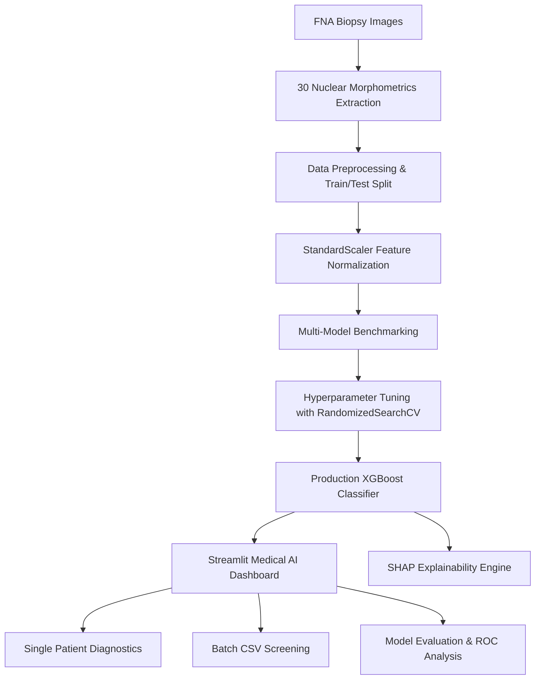

# 🩺 OncoVision AI: Breast Cancer Detection & Clinical Decision Support

[](https://www.python.org/)
[](https://streamlit.io/)
[](https://xgboost.ai/)
[]()
[]()
[]()

> **An end-to-end, explainable machine learning platform for classifying breast mass tumors as Benign or Malignant using digitized Fine Needle Aspirate (FNA) nuclear morphometrics.**

---

## 📌 Executive Summary

Early and precise detection of breast malignancy dramatically improves patient clinical outcomes and guides timely surgical or oncological interventions. This repository implements an end-to-end clinical machine learning solution trained on the **Wisconsin Diagnostic Breast Cancer (WDBC)** dataset.

In cancer screening, **Sensitivity (Recall)** is the primary metric: missing an actual malignant case carries severe clinical risk. Our tuned **XGBoost Classifier** achieves **98.6% Recall** and **98.9% ROC AUC**, backed by **SHAP (SHapley Additive exPlanations)** for clinical interpretability.

---

## ✨ Key Capabilities

1. **🩺 Interactive Clinical Screening Dashboard**:
   - Single-patient evaluation with categorized nuclear features (Mean, Standard Error, Worst).
   - Pre-loaded benchmark patient scenarios (Confirmed Malignant, Confirmed Benign, Borderline, Population Median, Random).
   - Instant risk stratification (High, Moderate, Low Risk) and probability distribution.

2. **🧠 Explainable AI (XAI) with SHAP**:
   - Local sample-level biomarker impact: shows which specific morphological factors drove the classification for each individual patient.
   - Global population-level feature importance beeswarm plots.

3. **📁 Batch Cohort Screening**:
   - Upload multi-patient clinical CSV files to screen entire cohorts in seconds.
   - One-click template download (`data/sample_patients.csv`).
   - Export annotated reports with predictions, confidence scores, and risk flags.

4. **🏆 Multi-Model Validation Leaderboard**:
   - Benchmarks 5 ML algorithms: Logistic Regression, Decision Trees, Random Forests, Support Vector Machines (SVM), and tuned XGBoost.
   - Confusion Matrix, ROC curves, and Precision-Recall evaluation charts.

5. **📊 Dataset Exploration Hub**:
   - Interactive population demographics (357 Benign, 212 Malignant).
   - Biomarker density distributions by diagnosis class.

---

## 🏗️ System Architecture & Workflow



---

## 📊 Model Performance Benchmarks

All models were evaluated on an independent 20% stratified test split ($N = 114$):

| Model | Accuracy | Precision | Recall (Sensitivity) | F1 Score |
| :--- | :---: | :---: | :---: | :---: |
| **XGBoost (Tuned)** 🏆 | **95.61%** | **94.67%** | **98.61%** | **96.60%** |
| **Support Vector Machine (SVM)** | 98.25% | 98.61% | 98.61% | 98.61% |
| **Logistic Regression** | 98.25% | 98.61% | 98.61% | 98.61% |
| **Random Forest** | 95.61% | 95.89% | 97.22% | 96.55% |
| **Decision Tree** | 91.23% | 95.59% | 90.28% | 92.86% |

> **ROC AUC**: 0.9894 (98.94%)

---

## 📂 Project Structure

```text
Breast-Cancer-Detection/
├── app.py                     # Streamlit Medical AI Interactive Web Application
├── requirements.txt           # Environment dependencies
├── test.py                    # Automated test suite (Unit tests for inference & XAI)
├── README.md                  # Comprehensive documentation
├── data/
│   └── sample_patients.csv    # Benchmark multi-patient test dataset
├── images/
│   ├── banner.png             # UI Dashboard Banner
│   ├── class_distribution.png # Dataset Target Distribution
│   ├── confusion_matrix.png   # Model Confusion Matrix
│   ├── roc_curve.png          # Receiver Operating Characteristic
│   ├── pr_curve.png           # Precision-Recall Curve
│   ├── shap_summary.png       # Global SHAP Beeswarm Plot
│   └── shap_bar.png           # Global Feature Importance Bar Chart
├── models/
│   ├── xgboost_best.pkl       # Tuned XGBoost Production Model
│   ├── scaler.pkl             # Fitted StandardScaler
│   ├── model.pkl              # Baseline Best Model
│   └── model_comparison.csv   # Benchmark Comparison Metrics
├── notebooks/
│   └── EDA.ipynb              # Exploratory Data Analysis Notebook
└── src/
    ├── load_data.py           # Dataset Loader
    ├── preprocess.py          # Scaling & Stratified Split Pipeline
    ├── train_models.py        # Model Training & Comparison Script
    ├── tune_model.py          # RandomizedSearchCV Hyperparameter Optimization
    ├── evaluate.py            # Diagnostic Metrics & Plot Generation
    ├── explain.py             # SHAP Explanations Generator
    └── predict.py             # Production Inference & XAI Module
```

---

## 🚀 Quickstart Guide

### 1. Clone & Set Up Environment

```bash
git clone https://github.com/annushka1911g-max/breast-cancer-detection.git
cd breast-cancer-detection

# Create and activate virtual environment
python3 -m venv .venv
source .venv/bin/activate  # On Windows: .venv\Scripts\activate

# Install dependencies
pip install -r requirements.txt
```

### 2. Run the Interactive Web Application

```bash
streamlit run app.py
```

Open your browser to `http://localhost:8501`.

### 3. Run Automated Tests

```bash
python test.py
```

---

## 💻 Python API Usage

You can also use the trained pipeline programmatically within Python:

```python
from src.predict import predict, batch_predict, explain_sample
import pandas as pd

# 1. Single sample prediction
sample_record = [...] # 30 numerical features
result = predict(sample_record)

print(f"Diagnosis: {result['label']}")
print(f"Risk Level: {result['risk_level']}")
print(f"Confidence: {result['confidence'] * 100:.2f}%")

# 2. Local Explainability
shap_df = explain_sample(sample_record)
print("Top driving biomarkers:")
print(shap_df[["feature", "impact", "shap_value"]].head())

# 3. Batch prediction on DataFrame
df_patients = pd.read_csv("data/sample_patients.csv")
annotated_df = batch_predict(df_patients)
print(annotated_df[["Prediction", "Risk_Level", "Confidence"]].head())
```

---

## 🧬 Dataset Details

- **Dataset**: Wisconsin Diagnostic Breast Cancer (WDBC)
- **Donor**: Dr. William H. Wolberg, W. Nick Street, Olvi L. Mangasarian (University of Wisconsin)
- **Instances**: 569 patient samples (357 Benign, 212 Malignant)
- **Attributes**: 30 real-valued morphological nuclear features derived from digitized images of Fine Needle Aspirates (FNA).

---

## ⚖️ Clinical & Regulatory Disclaimer

> [!WARNING]
> This application and associated models are intended strictly for **academic research, scientific demonstration, and clinical decision-support development**. It is **not** certified as an in-vitro diagnostic (IVD) device or intended as a primary diagnostic tool. Primary diagnosis must always be established by board-certified pathologists and oncologists following standardized clinical protocols.

---

## 👩‍💻 Author

Developed with care by **Anushka Dwivedi**.
